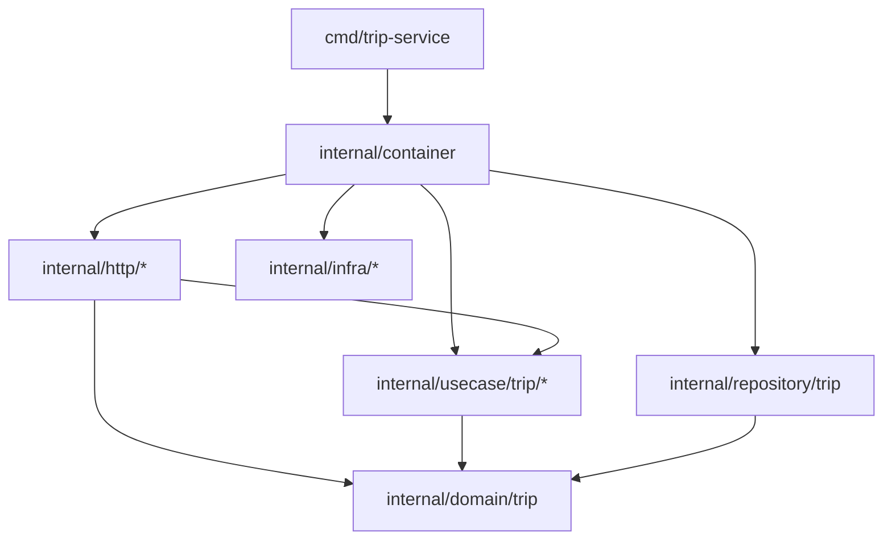

# TripGo — trip-service

Сервис управления поездками (курс «Разработка микросервисов на Go», лабораторные работы 1–2):
HTTP API по контракту OpenAPI, PostgreSQL (`pgxpool` + `squirrel`), контекстный менеджер транзакций,
многослойная архитектура с контролем зависимостей (`depguard`), модульные и интеграционные тесты,
структурные логи (`slog`) и телеметрия OpenTelemetry (трейсы в Jaeger, метрики в Prometheus/Grafana).

## Требования

- Go 1.26+ (`oapi-codegen`, `goose` и `mockgen` подключены как `tool`-зависимости в `go.mod` и вызываются через `go tool`)
- `golangci-lint` v2 (`go install github.com/golangci/golangci-lint/v2/cmd/golangci-lint@latest`)
- [`tripgoctl`](https://github.com/course-go-autumn-2026) — поднимает PostgreSQL и стек observability (OTel Collector, Jaeger, Prometheus, Grafana)
- `make`, `curl` (и по желанию `jq`)

## Запуск из чистого клона

```bash
git clone git@github.com:aquamarine66/tripgo-course.git
cd tripgo-course
git checkout homework/02

# 1. Поднять окружение лабораторной 2 (PostgreSQL + OTel Collector + Jaeger + Prometheus + Grafana)
tripgoctl cluster start          # один раз на машине
tripgoctl environment start      # создаёт актуальный .env с портами ЛР2
tripgoctl connect                # печатает адреса БД, OTLP и ссылки на Jaeger / Grafana / Prometheus

# 2. Накатить миграции и запустить сервис
make migrate
make run
```

## Цели Makefile

| Цель | Что делает |
|---|---|
| `make generate` | генерирует `internal/generated/api.gen.go` из OpenAPI и все `mocks_test.go` через `go generate ./internal/...` |
| `make migrate` | накатывает все миграции (`goose up`) |
| `make migrate-down` | откатывает последнюю миграцию (`goose down`) |
| `make migrate-status` | выводит статус миграций |
| `make run` | запускает сервис локально |
| `make build` | собирает бинарь в `bin/trip-service` |
| `make test` | запускает все unit-тесты с `-race` и печатает покрытие `internal/domain/...` и `internal/usecase/...` |
| `make test-integration` | запускает интеграционные тесты репозитория и менеджера транзакций (`-tags=integration -race`) на реальном PostgreSQL |
| `make lint` | запускает `golangci-lint run ./...` с конфигом `.golangci.yml` |

## Переменные окружения

Все настройки берутся из переменных окружения (`.env` генерируется `tripgoctl environment start`, шаблон — в `.env.example`). При отсутствии обязательной `DATABASE_URL` или при невалидных значениях чисел/таймаутов сервис завершает старт с ошибкой.

| Переменная | По умолчанию | Описание |
|---|---|---|
| `DATABASE_URL` | — (обязательна) | строка подключения к PostgreSQL |
| `HTTP_ADDR` | `:8080` | адрес HTTP-сервера |
| `LOG_LEVEL` | `info` | уровень логирования (`debug`, `info`, `warn`, `error`) |
| `SHUTDOWN_TIMEOUT` | `10s` | общий бюджет graceful shutdown |
| `HTTP_READ_TIMEOUT` | `5s` | `http.Server.ReadTimeout` |
| `HTTP_READ_HEADER_TIMEOUT` | `2s` | `http.Server.ReadHeaderTimeout` |
| `HTTP_WRITE_TIMEOUT` | `10s` | `http.Server.WriteTimeout` |
| `HTTP_IDLE_TIMEOUT` | `120s` | `http.Server.IdleTimeout` |
| `DATABASE_MAX_CONNS` | `10` | максимум соединений в пуле (`>= 1`) |
| `DATABASE_MIN_CONNS` | `2` | минимум соединений в пуле (`<= DATABASE_MAX_CONNS`) |
| `DATABASE_MAX_CONN_LIFETIME` | `30m` | максимальное время жизни соединения |
| `DATABASE_CONNECT_TIMEOUT` | `5s` | таймаут подключения и стартового `Ping` |
| `DATABASE_QUERY_TIMEOUT` | `3s` | таймаут каждого SQL-запроса и readiness-пробы `/ready` |
| `OTEL_SERVICE_NAME` | `trip-service` | `service.name` ресурса OpenTelemetry и поле `service` в логах |
| `OTEL_SERVICE_VERSION` | `0.2.0` | `service.version` ресурса OpenTelemetry |
| `OTEL_RESOURCE_ATTRIBUTES` | `service.namespace=tripgo,deployment.environment=local` | атрибуты ресурса OTel |
| `OTEL_EXPORTER_OTLP_ENDPOINT` | `http://localhost:4318` | адрес OTLP/HTTP-коллектора |
| `OTEL_EXPORTER_OTLP_PROTOCOL` | `http/protobuf` | протокол экспорта OTLP |
| `OTEL_TRACES_SAMPLER` | `parentbased_always_on` | стратегия сэмплирования трейсов |

## Тесты и линтер

```bash
# Линтер (включая проверку архитектурных границ depguard и форматтеры gofumpt/gci)
make lint

# Unit-тесты (домен, юзкейсы с gomock, маппинг ошибок, HTTP-хендлеры с httptest, middleware)
# Печатает покрытие пакетов internal/domain и internal/usecase (>= 94–100%)
make test

# Интеграционные тесты репозитория и транзакций на реальном PostgreSQL (build tag: integration)
make migrate
make test-integration
```

Каждый интеграционный тест сам создаёт свои записи со случайными UUID и удаляет их в `t.Cleanup`, поэтому тесты изолированы и проходят при повторных запусках (`-count=2`).

## Архитектура

### Слои и структура пакетов

Код организован по двум принципам: **«пакет на действие, а не файл на слой»** и **«инфраструктура отдельно от бизнес-логики»**:

```
cmd/trip-service/                 точка входа: читает конфиг, создаёт container, ждёт сигнала остановки
internal/
  config/                         чтение и валидация переменных окружения
  container/                      composition root: создаёт все реализации и связывает их вручную
  domain/
    trip/                         доменная сущность Trip, Coordinates, метод Finish, доменные ошибки и ValidationError
  model/                          межслойные структуры (Trip, CreateTripInput, StatusChange) и конвертеры в/из домена
  usecase/
    trip/
      create/                     юзкейс создания поездки (usecase.go, contract.go, usecase_test.go, mocks_test.go)
      get/                        юзкейс получения поездки
      finish/                     юзкейс завершения поездки
  http/
    router.go                     сборка chi-роутера, подключение middleware и сгенерированного ServerInterface
    domainerror/                  единая точка перевода ошибок в RFC 9457 Problem (application/problem+json)
    middleware/                   Recover → Tracing → Logging → Metrics
    trip/
      create/                     HTTP-хендлер POST /api/v1/trips (handler.go, contract.go, convert.go, тесты и моки)
      get/                        HTTP-хендлер GET /api/v1/trips/{tripId}
      finish/                     HTTP-хендлер POST /api/v1/trips/{tripId}/finish
      response/                   преобразование model.Trip в контрактный JSON-ответ
  repository/
    trip/                         PostgreSQL-репозиторий на pgx + squirrel (repo.go, save.go, fetch.go, convert.go, интеграционные тесты)
  infra/
    postgres/                     инициализация pgxpool и pgx.QueryTracer для спанов и метрик БД
      transaction/                контекстный менеджер транзакций (Do)
    telemetry/                    инициализация OpenTelemetry SDK (OTLP HTTP), метрик и slog JSON-логгера с trace_id/span_id
  generated/                      сгенерированный oapi-codegen код (api.gen.go)
migrations/                       SQL-миграции goose
contracts/                        контракты курса (OpenAPI, schema.md)
```

### Направление зависимостей и где объявлены интерфейсы



- **Зависимости направлены строго внутрь:**
  - `internal/domain/trip` не импортирует ни `net/http`, ни `chi`, ни `pgx`, ни `squirrel`, ни `otel`, ни `internal/generated`.
  - `internal/usecase/...` зависит только от `internal/domain/trip` и `internal/model` и не знает про HTTP-транспорт, SQL или драйвер БД.
  - `internal/http/...` не знает про `internal/repository/*` и `internal/infra/*`.
  - Эти границы автоматически проверяются линтером `depguard` в [`.golangci.yml`](.golangci.yml).
- **Интерфейсы объявлены на стороне потребителя** в файлах `contract.go` каждого пакета и сделаны неэкспортируемыми:
  - `internal/usecase/trip/create/contract.go` объявляет только те методы репозитория (`Save`, `AddStatusHistory`), `txManager` (`Do`) и `tripMetrics` (`IncTripCreated`), которые нужны именно созданию поездки;
  - `internal/usecase/trip/finish/contract.go` объявляет `GetByIDForUpdate`, `Update`, `AddStatusHistory`, `txManager` и `IncTripCompleted`;
  - `internal/usecase/trip/get/contract.go` объявляет только `GetByID`;
  - каждый HTTP-хендлер (`internal/http/trip/{create,get,finish}/contract.go`) объявляет свой узкий интерфейс `useCase`.
- **Почему так:** потребитель сам формулирует минимальный контракт, который ему нужен (Interface Segregation + Dependency Inversion). Моки генерируются `mockgen` через `//go:generate` прямо в `mocks_test.go` рядом с кодом. Когда в лабораторной работе 4 появится второй транспорт (gRPC и консьюмер Kafka), ни домен, ни юзкейсы, ни репозиторий менять не придётся — новые адаптеры просто вызовут существующие юзкейсы.
- **Единая точка сборки (`internal/container`):** все конкретные реализации (`pgxpool`, `transaction.Manager`, `triprepo.Repository`, телеметрия, юзкейсы, HTTP-хендлеры) создаются и связываются только в `container.New`. В `main.go` остаётся только чтение конфига, вызов `container.New` и `app.Run`. Глобальных синглтонов (`slog.Default()`, глобального пула БД) в бизнес-коде нет.

## Observability (OpenTelemetry, логи, метрики, трейсы)

- **Логи (`internal/infra/telemetry/logger.go`, `internal/http/middleware`):**
  - `log/slog` с JSON-хендлером в `stdout`, уровень задаётся через `LOG_LEVEL`.
  - Обёртка `traceHandler` автоматически извлекает активный спан из `ctx` и добавляет в каждую запись `trace_id` и `span_id`, а также постоянный атрибут `"service": "trip-service"`.
  - На каждый HTTP-запрос middleware пишет одну итоговую запись `"msg": "request handled"` с полями `method`, `route` (шаблон маршрута `/api/v1/trips/{tripId}`, без подставленного UUID), `status`, `duration_ms`, `trace_id`, `span_id`. Для `2xx`/`4xx` уровень `INFO`, для `5xx` — `ERROR`.
  - Бизнес-события (`"trip created"`, `"trip completed"`) логируются на уровне `INFO` внутри соответствующих юзкейсов с `trip_id`, `trace_id` и `span_id`.
- **Трейсы (`internal/infra/telemetry/otel.go`, `internal/infra/postgres/pool.go`):**
  - Экспорт по OTLP/HTTP (`otlptracehttp`) в коллектор из `OTEL_EXPORTER_OTLP_ENDPOINT`. При недоступном коллекторе сервис продолжает штатно обслуживать запросы.
  - Middleware `Tracing` извлекает `W3C TraceContext` из входящих заголовков и открывает корневой серверный спан с именем `{method} {http.route}` (например, `POST /api/v1/trips/{tripId}/finish`).
  - На уровне пула `pgxpool` подключён `postgres.PoolTracer` (`pgx.QueryTracer`), который автоматически создаёт дочерний спан на каждый SQL-запрос с атрибутами `db.operation.name` (`SELECT`, `INSERT`, `UPDATE`) и `db.collection.name` (`trips`, `trip_status_history`), не загрязняя код репозитория телеметрией.
- **Метрики (`internal/infra/telemetry/metrics.go`):**
  - `http.server.request.duration` (histogram, `s`) — лейблы `http.request.method`, `http.route` (шаблон!), `http.response.status_code`.
  - `http.server.active_requests` (up-down counter) — лейблы `http.request.method`, `http.route`.
  - `db.client.operation.duration` (histogram, `s`) — лейблы `db.operation.name`, `db.collection.name`, `error.type`.
  - `tripgo.trips.created` (counter) — количество созданных поездок.
  - `tripgo.trips.completed` (counter) — количество завершённых поездок.
  - `tripgo.trips.active` (observable gauge) — текущее число активных поездок.
- **Порядок HTTP middleware (`internal/http/router.go`):**
  `Recover → Tracing → Logging → Metrics → роутер`.

## Ключевые технические решения

- **Менеджер транзакций и уровень изоляции `READ COMMITTED`:**
  `transaction.Manager.Do(ctx, fn)` открывает транзакцию с явным уровнем `pgx.ReadCommitted`, кладёт `pgx.Tx` в `context.Context` и выполняет `fn`. При `nil` делается `COMMIT`, при ошибке или панике — `ROLLBACK` (с `context.WithoutCancel(ctx)`, чтобы откат дошёл до БД даже при отмене клиентского контекста), после чего ошибка или паника пробрасывается наружу. Вложенный `Do` обнаруживает уже открытую транзакцию в контексте и переиспользует её. Уровень `READ COMMITTED` выбран потому, что конкурентные инварианты защищены на уровне самой БД (частичный уникальный индекс при создании и `SELECT ... FOR UPDATE` при завершении), которые надёжно работают на `READ COMMITTED` и не требуют `SERIALIZABLE` с ретраями ошибок сериализации `40001`.
- **Защита от гонок при создании и завершении поездки:**
  - *Создание:* частичный уникальный индекс `CREATE UNIQUE INDEX trips_driver_active_uniq ON trips (driver_id) WHERE status = 'active'` гарантирует, что из двух параллельных запросов на одного водителя один получит `23505 unique_violation` → `domaintrip.ErrDriverBusy` → `409 driver_busy`.
  - *Завершение:* внутри транзакции `finish.UseCase` читает строку через `SELECT ... FROM trips WHERE id = $1 FOR UPDATE` (`GetByIDForUpdate`), блокируя её для параллельных `finish`, затем вызывает доменный метод `entity.Finish(now)` (который проверяет `Status == StatusActive` и иначе возвращает `domaintrip.ErrTripCompleted` → `409 trip_completed`), обновляет строку и пишет переход в `trip_status_history`.
- **Единый маппинг ошибок (`internal/http/domainerror`):**
  Все хендлеры передают любую ошибку в `domainerror.Write(w, r, logger, err)`. Функция `domainerror.Problem` в одном `switch` переводит `ValidationError`/`InvalidParamFormatError` → `400 invalid_request`, `ErrTripNotFound` → `404 trip_not_found`, `ErrTripCompleted` → `409 trip_completed`, `ErrDriverBusy` → `409 driver_busy`, а любую неизвестную ошибку логирует на уровне `ERROR` и отдаёт клиенту как `500 internal_error` с безопасным текстом `"Internal server error"` без утечки деталей SQL или драйвера.
