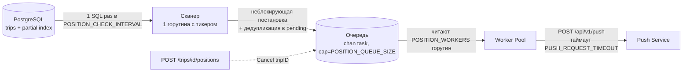

# TripGo — trip-service

Сервис управления поездками (курс «Разработка микросервисов на Go», лабораторные работы 1–3):
HTTP API по контракту OpenAPI, PostgreSQL (`pgxpool` + `squirrel`), контекстный менеджер транзакций,
многослойная архитектура с контролем зависимостей (`depguard`), трекинг маршрута поездки,
фоновый опрос устаревших поездок (сканер → ограниченная очередь → worker pool → HTTP-гейтвей Push Service),
структурные логи (`slog`) и телеметрия OpenTelemetry (`otelhttp`, `otelpgx`, span links, метрики в Prometheus/Grafana).

## Требования

- Go 1.26+ (`oapi-codegen`, `goose` и `mockgen` подключены как `tool`-зависимости в `go.mod` и вызываются через `go tool`)
- `golangci-lint` v2 (`go install github.com/golangci/golangci-lint/v2/cmd/golangci-lint@latest`)
- [`tripgoctl`](https://github.com/course-go-autumn-2026) — поднимает PostgreSQL, стек observability (OTel Collector, Jaeger, Prometheus, Grafana) и заглушку Push Service
- `make`, `curl`

## Запуск из чистого клона

```bash
git clone git@github.com:aquamarine66/tripgo-course.git
cd tripgo-course
git checkout homework/03

# 1. Поднять окружение лабораторной 3 (PostgreSQL + Observability + Push Service)
tripgoctl cluster start          # один раз на машине
tripgoctl environment start      # создаёт актуальный .env с адресами БД, OTLP и Push Service
tripgoctl connect                # печатает адреса БД, OTLP, Push Service и ссылки на Jaeger / Grafana / Prometheus

# 2. Накатить миграции и запустить сервис
make migrate
make run
```

## Цели Makefile

| Цель | Что делает |
|---|---|
| `make generate` | генерирует `internal/generated/api.gen.go` из OpenAPI и все `mocks_test.go` через `go generate ./internal/...` |
| `make migrate` | накатывает все миграции (`goose up`) |
| `make migrate-down` | откатывает последнюю миграцию (`goose down`) |
| `make migrate-status` | выводит статус миграций |
| `make run` | запускает сервис локально |
| `make build` | собирает бинарь в `bin/trip-service` |
| `make test` | запускает все unit-тесты с `-race` и печатает покрытие `internal/domain/...` и `internal/usecase/...` |
| `make test-integration` | запускает интеграционные тесты репозитория на реальном PostgreSQL (`-tags=integration -race -count=1`) |
| `make lint` | запускает `golangci-lint run ./...` с конфигом `.golangci.yml` |

## Переменные окружения

Все настройки берутся из переменных окружения (`.env` генерируется `tripgoctl environment start`, шаблон — в `.env.example`). При отсутствии обязательных переменных (`DATABASE_URL`, `PUSH_HTTP_URL`) или невалидных числах/таймаутах/протоколе OTLP сервис завершает старт с ошибкой.

| Переменная | По умолчанию | Описание |
|---|---|---|
| `DATABASE_URL` | — (обязательна) | строка подключения к PostgreSQL |
| `HTTP_ADDR` | `:8080` | адрес HTTP-сервера |
| `LOG_LEVEL` | `info` | уровень логирования (`debug`, `info`, `warn`, `error`) |
| `SHUTDOWN_TIMEOUT` | `10s` | общий бюджет graceful shutdown |
| `HTTP_READ_TIMEOUT` | `5s` | `http.Server.ReadTimeout` |
| `HTTP_READ_HEADER_TIMEOUT` | `2s` | `http.Server.ReadHeaderTimeout` |
| `HTTP_WRITE_TIMEOUT` | `10s` | `http.Server.WriteTimeout` |
| `HTTP_IDLE_TIMEOUT` | `120s` | `http.Server.IdleTimeout` |
| `DATABASE_MAX_CONNS` | `10` | максимум соединений в пуле (`>= 1`) |
| `DATABASE_MIN_CONNS` | `2` | минимум соединений в пуле (`<= DATABASE_MAX_CONNS`) |
| `DATABASE_MAX_CONN_LIFETIME` | `30m` | максимальное время жизни соединения |
| `DATABASE_CONNECT_TIMEOUT` | `5s` | таймаут подключения и стартового `Ping` |
| `DATABASE_QUERY_TIMEOUT` | `3s` | таймаут каждого SQL-запроса и readiness-пробы `/ready` |
| `OTEL_SERVICE_NAME` | `trip-service` | `service.name` ресурса OpenTelemetry и поле `service` в логах |
| `OTEL_SERVICE_VERSION` | `0.3.0` | `service.version` ресурса OpenTelemetry |
| `OTEL_RESOURCE_ATTRIBUTES` | `service.namespace=tripgo,deployment.environment=local` | атрибуты ресурса OTel |
| `OTEL_EXPORTER_OTLP_ENDPOINT` | — | адрес OTLP-коллектора (если пусто — экспорт по сети отключён) |
| `OTEL_EXPORTER_OTLP_PROTOCOL` | `http/protobuf` | протокол экспорта OTLP (`http/protobuf` или `grpc`) |
| `OTEL_TRACES_SAMPLER` | `parentbased_always_on` | стратегия сэмплирования (`always_on`, `always_off`, `traceidratio`, `parentbased_*`) |
| `OTEL_TRACES_SAMPLER_ARG` | `1.0` | доля сэмплирования `[0, 1]` для `traceidratio` / `parentbased_traceidratio` |
| `POSITION_CHECK_INTERVAL` | `30s` | период тикера сканера устаревших поездок (и минимальная пауза между повторными пушами) |
| `POSITION_STALE_AFTER` | `60s` | время без свежих координат, после которого поездка считается устаревшей |
| `POSITION_WORKERS` | `4` | фиксированное количество воркеров пула (`>= 1`) |
| `POSITION_QUEUE_SIZE` | `100` | ёмкость буферизованной очереди задач (`>= 1`) |
| `PUSH_HTTP_URL` | — (обязательна) | базовый URL Push Service (подставляется `tripgoctl` в `.env`) |
| `PUSH_REQUEST_TIMEOUT` | `1s` | таймаут одного HTTP-запроса в Push Service |

## Опрос устаревших поездок

### Схема работы



1. **Выборка из БД (`FindStaleActive`)**: на каждом тике одна фоновая горутина сканера выполняет один SQL-запрос, отбирая поездки со статусом `active`, у которых `COALESCE(last_position_at, started_at) < now() - POSITION_STALE_AFTER`, отсортированные по возрастанию (самые давно молчащие — первыми). Для запроса создана отдельная `CONCURRENTLY`-миграция с частичным индексом `trips_active_last_activity_idx ON trips ((COALESCE(last_position_at, started_at))) WHERE status = 'active'`; `EXPLAIN (ANALYZE)` подтверждает `Index Scan` без дополнительной сортировки.
2. **Очередь и дедупликация (`internal/worker/positions`)**: очередь реализована как буферизованный канал фиксированной ёмкости `POSITION_QUEUE_SIZE`. Параллельно под `sync.Mutex` поддерживается таблица `pending map[uuid.UUID]uint64` (ID поездки → монотонный токен). Проверка наличия в `pending`, неблокирующая запись в канал и регистрация токена выполняются под одним мьютексом, поэтому одна поездка не может оказаться в очереди дважды даже при наложении тиков и обработки.
3. **Отмена при приходе координаты**: после успешного коммита сохранения координаты `addposition.UseCase` вызывает `Cancel(tripID)`, удаляя поездку из `pending`. Когда воркер достанет уже лежавшую в канале задачу и не найдёт совпадения токена в `pending`, он молча отбросит её без вызова Push Service.
4. **Пул воркеров и гейтвей (`internal/gateway/push`)**: на старте поднимается ровно `POSITION_WORKERS` горутин (горутины на задачу не плодятся). Каждый воркер открывает новый корневой спан `positions.request` со **span link** на спан сканера `positions.scan` и вызывает Push Service (`kind = "REQUEST_POSITION"`, `recipient_id = driver_id`, `data.trip_id = trip_id`) через собственный `http.Client` с таймаутом `PUSH_REQUEST_TIMEOUT` и транспортом `otelhttp`. Ошибки сети, `4xx` и `5xx` различаются, логируются уровнем `Warn` и не роняют воркер.
5. **Сохранение координаты**: `POST /api/v1/trips/{tripId}/positions` в одной транзакции (`TxManager`) блокирует поездку (`FOR UPDATE`), проверяет статус `active`, вставляет точку в `trip_positions` и обновляет `trips.last_position_at` через SQL-выражение `CASE WHEN last_position_at IS NULL OR last_position_at < $1 THEN $1 ELSE last_position_at END`, чтобы опоздавшая офлайн-точка не откатывала время назад.

### Параметры конфигурации

| Параметр | По умолчанию | Роль |
|---|---|---|
| `POSITION_CHECK_INTERVAL` | `30s` | частота тиков сканера и пауза перед повторным запросом, если устройство не ответило |
| `POSITION_STALE_AFTER` | `60s` | порог «молчания» поездки (от `last_position_at`, либо от `started_at`, если координат ещё не было) |
| `POSITION_WORKERS` | `4` | фиксированное число воркеров, одновременно ходящих в Push Service |
| `POSITION_QUEUE_SIZE` | `100` | предел буфера очереди задач |
| `PUSH_HTTP_URL` | обязателен | адрес HTTP API Push Service |
| `PUSH_REQUEST_TIMEOUT` | `1s` | таймаут обработки одной задачи |

### Что происходит при исчерпании очереди

Запись в очередь выполняется через неблокирующий `select { case p.queue <- t: ... default: ... }`. Если очередь заполнена (например, Push Service отвечает медленно, все воркеры заняты и буфер `POSITION_QUEUE_SIZE` полон):

- сканер **не блокируется** и завершает тик штатно, а HTTP-ручки сервиса продолжают отвечать без деградации;
- лишняя задача **отбрасывается (drop)** и не добавляется в `pending`;
- инкрементируются метрики `tripgo.stale_checks{result="dropped"}` и `tripgo.position_requests{result="dropped"}`;
- пишется предупреждение в лог уровня `Warn` с `trip_id`, `driver_id` и размером очереди;
- на следующем тике (через `POSITION_CHECK_INTERVAL`) отброшенная поездка снова попадёт в SQL-выборку и будет опрошена, как только освободится место.

### Порядок Graceful Shutdown

При получении `SIGINT` / `SIGTERM` остановка выполняется строго в 4 шага в пределах общего `SHUTDOWN_TIMEOUT` (`internal/container/container.go`):

1. `httpSrv.Shutdown(shutdownCtx)` — перестаём принимать новые HTTP-запросы и дожидаемся завершения текущих.
2. `posPool.StopScanner()` — останавливаем тикер сканера, ждём окончания активного тика и закрываем канал очереди (новые задачи больше не поступают).
3. `posPool.WaitWorkers(shutdownCtx)` — воркеры доразбирают оставшиеся в очереди задачи в пределах оставшегося бюджета; если `SHUTDOWN_TIMEOUT` истёк, контекст воркеров принудительно отменяется и сервис дожидается их выхода.
4. Закрываются простаивающие соединения `pushClient.Close()`, сбрасываются батчи телеметрии `providers.Shutdown` и закрывается пул БД `pool.Close()`.

## Тесты и линтер

```bash
# Линтер (включая архитектурные границы depguard, gofumpt и gci)
make lint

# Unit-тесты (-race, покрытие domain и usecase, goleak в internal/worker/positions)
make test
go test -race -count=2 ./...

# Интеграционные тесты репозитория и транзакций на реальном PostgreSQL
make migrate
make test-integration
```

## Архитектура

```text
cmd/trip-service/                 точка входа: конфиг, container.New, сигналы остановки
internal/
  config/                         чтение и валидация переменных окружения
  container/                      composition root и последовательность graceful shutdown
  domain/
    trip/                         сущности Trip и Position, Coordinates, валидация и доменные ошибки
  model/                          межслойные DTO (Trip, TripPosition, StaleTrip, StatusChange)
  usecase/
    trip/
      create/                     создание поездки
      get/                        получение поездки
      finish/                     завершение поездки
      addposition/                транзакционное сохранение координаты + отмена задачи в очереди
      listpositions/              получение маршрута поездки
  http/
    router.go                     сборка chi-роутера и цепочки middleware
    domainerror/                  единый маппинг ошибок в RFC 9457 Problem
    middleware/                   Recover → Tracing (otelhttp) → Logging → Metrics
    trip/
      create/, get/, finish/      ручки поездок
      addposition/, listpositions/ ручки координат и маршрута
      response/                   JSON-DTO ответов по контракту OpenAPI
  worker/
    positions/                    сканер, ограниченная очередь, дедупликация, worker pool, тесты с goleak
  gateway/
    push/                         HTTP-клиент Push Service со своим http.Client и otelhttp.Transport
  repository/
    trip/                         PostgreSQL-репозиторий (pgx + squirrel) и интеграционные тесты
  infra/
    postgres/                     инициализация pgxpool с otelpgx.NewTracer и контекстный transaction.Manager
    telemetry/                    OpenTelemetry SDK (OTLP HTTP/gRPC), метрики ЛР2–ЛР3 и JSON slog-логгер
  generated/                      сгенерированный oapi-codegen код
migrations/                       SQL-миграции goose (00001–00004)
contracts/                        контракты курса (не редактируются)
```

## Observability (логи, метрики, трейсы)

- **Инструментирование:** входящий HTTP через `otelhttp.NewHandler` (имя спана `{method} {http.route}`, паники фиксируются в спане со статусом `Error` и логируются с `trace_id` до закрытия спана), исходящий HTTP в Push Service через `otelhttp.NewTransport`, PostgreSQL через `otelpgx.NewTracer`. Провайдеры и W3C `TraceContext` пропагатор передаются явно через `telemetry.Providers` без глобального состояния.
- **Span links:** каждый тик сканера создаёт спан `positions.scan`, а асинхронная обработка задачи воркером создаёт корневой спан `positions.request` со связью `trace.WithLinks` на породивший спан сканера.
- **Метрики:**
  - HTTP и БД: `http.server.request.duration`, `http.server.active_requests`, `db.client.operation.duration`.
  - Поездки и координаты: `tripgo.trips.created`, `tripgo.trips.completed`, `tripgo.positions.saved`.
  - Сканер и пул: `tripgo.stale_checks{result}`, `tripgo.position_requests.queue.size`, `tripgo.position_requests.workers.active`, `tripgo.position_requests{result}`, `tripgo.position_requests.duration{result}`.